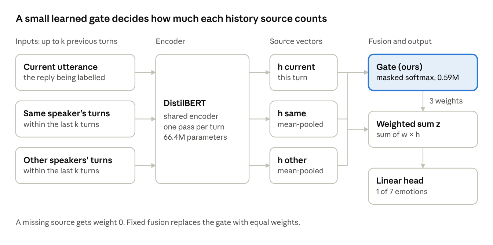

# When Does Context Help? Lightweight Speaker-Aware Context Weighting for Conversational Emotion Recognition

Revised 30 October 2026

EE6405 Natural Language Processing · Design Thinking Proposal, revised with results · six-member team

The project ran as proposed and grew from five models on two datasets to 237 configurations on three. The learned gate is the part that works: it beats equal weighting by 0.077 Macro-F1 on MELD (p < 0.001). Adaptive weighting does not beat the single-utterance model or concatenation, because the gate keeps about 85% of the weight on the current utterance.

This revision keeps the five design-thinking stages of the original proposal and replaces plans with what was built and measured. Numbers are test Macro-F1, mean ± standard deviation over seeds 42, 43 and 44, unless stated otherwise.

## What changed since the original proposal

| Item | Original proposal | Delivered |
| --- | --- | --- |
| Datasets | MELD (full study), EmoryNLP (key comparisons) | DailyDialog added as a supplementary benchmark without speaker IDs; EmoryNLP single-utterance baseline added |
| Traditional baselines | TF-IDF + logistic regression | 19 more term weighting × classifier pairs: binary, TF, TF-IDF, BM25 × logistic regression, linear SVM, multinomial and complement naive Bayes, random forest |
| Encoders | DistilBERT only | BERT-base, RoBERTa-base, RNN, LSTM and GRU (one- and bidirectional) on MELD, as a check on the encoder choice |
| Tuning | learning rates 2e-5 and 5e-5 | plus a one-at-a-time sweep of learning rate, batch size and dropout |
| Significance | mean ± std over three seeds | plus a paired bootstrap over test utterances, all three seeds |
| Compute | not fixed | 177 neural runs on one A40 GPU (15.4 GPU-hours), 60 traditional runs on CPU |
| Hypothesis | adaptive weighting helps most on short replies | not supported: every model scores 0.506 on them |
| Usability walkthrough | 3–5 classmates | not yet run |

## 1. Empathize — audience and purpose

The audience is unchanged: NLP engineers and researchers who decide how much dialogue history a model should use, and dialogue analysts who review model errors. Customer-service quality-assurance teams remain potential downstream users; applying the system to their conversations would need evaluation on their data, which this project does not do.

- **Need.** A reply such as "Fine." is ambiguous on its own, but a long history can bring in distracting exchanges. Developers need a controlled comparison of context strategies and an interface that shows when context changes a prediction.
- **Purpose.** Support evidence-based model choice and dialogue review. The Streamlit demo shows each model's prediction for every utterance side by side, the history each model sees and the gate's weights over the current utterance, the same speaker and other speakers.
- **Evidence for the needs.** They are design assumptions drawn from related research. No stakeholder interviews were held, and the classmate walkthrough that would test the interface has not been run yet (see Remaining work).

## 2. Define — problem and research questions

**Problem statement (unchanged).** NLP developers need an efficient way to use conversational context for emotion recognition, because isolated utterances can be ambiguous and fixed context strategies may include unhelpful information. We test whether separating context by speaker and learning its relative importance improves prediction at an acceptable computational cost.

**Task.** Assign one of seven emotion labels to each utterance from its text, its speakers and the preceding turns of the same dialogue. Gold labels of earlier turns are never model inputs.

| Research question | Answer | Evidence |
| --- | --- | --- |
| 1. How do the previous 1, 3 or 5 turns affect performance? | Barely on MELD; on EmoryNLP, context helps. | MELD adaptive 0.434 → 0.438 → 0.443, concatenation 0.426 → 0.428 → 0.424, single 0.437. EmoryNLP concatenation beats single by 0.022 (p = 0.009). |
| 2. Does separating same-speaker from other-speaker history help? | No clear gain, but the gate prefers the speaker's own history. | MELD separated 0.438 vs pooled 0.435 (p = 0.56); same-speaker weight 0.11 vs other-speaker 0.05. |
| 3. Does adaptive weighting add value over concatenation or fixed weighting? | Yes over fixed weighting; a tie with concatenation. | vs fixed +0.077 on MELD and +0.035 on EmoryNLP (both p < 0.001); vs concatenation +0.010 on MELD (p = 0.23). |

**Working hypothesis, now tested.** We expected adaptive weighting to help most on short utterances. It does not: on MELD replies of three words or fewer (27% of the test set), single, concatenation and adaptive weighting all score 0.506, and the gate's weights do not change with utterance length (correlation between −0.01 and +0.01).

## 3. Ideate — limitations and proposed solution

Single-utterance models miss conversational meaning. Concatenating recent turns adds context but mixes the speaker's own history with other participants' turns. Fixed-weight weighting separates the sources but weights them the same for every prediction.

Lu et al. (2020) describe interference from misleading context, and CoMPM (Lee and Lee, 2022) combines context modelling with a speaker-specific memory. Our method is a simplified shared-encoder adaptation of the CoMPM idea: a small gate learns, for each utterance, how much to trust the current utterance, the same speaker's earlier turns and other speakers' turns.

The proposed model is compared with traditional classifiers, a single-utterance Transformer, context concatenation and fixed weighting; fixed weighting is the matched control for the gate.

**Contributions as delivered**

1. **Implementation.** The weighting module and a reusable Python pipeline: pinned data downloads, one configuration generator for all 237 runs, resumable training and 114 passing tests.
2. **Empirical study.** Controlled comparisons and ablations of context length, speaker separation and adaptive weighting on three benchmarks (two with speaker IDs), with paired significance tests and a check across eight other encoders.
3. **Decision support.** A Streamlit demo plus parameter-count and latency analysis, so users can see what context changes and what it costs.

Speaker-aware modelling is an established direction. Our contribution is the documented adaptation, the implementation and the measured findings, including the ones where the proposed model does not win.

## 4. Prototype — architecture, data and implementation

**Inputs.** Each prediction uses the current utterance, the speaker IDs, the turn order and the previous k turns of the same dialogue (k = 1, 3 or 5). Every utterance keeps its first 80 word pieces in every model, so all context models see the same text.

**Architecture.** A shared DistilBERT encoder (66.4M parameters) turns each utterance into a vector. History vectors are mean-pooled by their relation to the current speaker. A two-layer gate (0.59M parameters, 0.9% of the model) with a masked softmax gives one weight per available source, and a linear head predicts the emotion:

```math
z = w_{\mathrm{current}}\,h_{\mathrm{current}} + w_{\mathrm{same}}\,h_{\mathrm{same}} + w_{\mathrm{other}}\,h_{\mathrm{other}}
```



Every turn passes through the same encoder; the gate reads the three source vectors and sets their weights separately for each utterance.

A missing source gets weight 0, so the first turn uses the current utterance alone. Encoder, gate and head are fine-tuned together with cross-entropy, AdamW, learning rates 2e-5 and 5e-5, up to 5 epochs and batch size 16; the (learning rate, epoch) with the best dev Macro-F1 is kept and scored on test once.

**Datasets.** All counts match the published ones; official splits are used as released.

| Dataset | Train / dev / test utterances | Labels | Speaker IDs | Use |
| --- | --- | --- | --- | --- |
| MELD | 9,989 / 1,109 / 2,610 | anger, disgust, fear, joy, neutral, sadness, surprise | yes | full study |
| EmoryNLP (original text release) | 9,934 / 1,344 / 1,328 | joyful, mad, neutral, peaceful, powerful, sad, scared | yes | replication |
| DailyDialog (added) | 87,170 / 8,069 / 7,740 | anger, disgust, fear, happiness, no\_emotion, sadness, surprise | no | supplementary benchmark |

MELD and EmoryNLP are both *Friends* transcripts; DailyDialog is written everyday English. All three are heavily imbalanced (MELD train is 47.2% neutral, 2.7% fear). DailyDialog has no speaker IDs, so it runs merged versions of fixed and adaptive weighting that pool all history into one source; it cannot test speaker separation.

**Data preparation.** As proposed: punctuation, negation, dialogue boundaries and turn order are kept; vocabularies are fitted on train only. In addition, MELD and EmoryNLP downloads are pinned and checked by SHA-256; joint speakers such as "Joey and Chandler" become a two-speaker list; one DailyDialog dialogue with a missing label is repaired; re-used scenes and duplicate texts are flagged, not removed. Every column used and every step is listed in [DATA.md](DATA.md).

**Demo.** A Streamlit app runs on a laptop CPU. Users pick a featured or test-set dialogue (or type their own) and see each model's prediction per utterance, the history it used and the gate weights; a Results tab shows the charts and a panel on model size and latency.

**Implementation and compute.** Python with pandas, scikit-learn, PyTorch and Hugging Face Transformers. All neural runs used one NVIDIA A40 on NTU EEE Cluster 02, so latencies are comparable: 7.75 GPU-hours for the original study and 7.66 for the model comparison.

**Ownership.** The six roles of the original proposal were kept: data preparation, basic baselines, context baselines, proposed method, evaluation and analysis, inference and demonstration. One addition: the model comparison (other encoders, traditional baselines, sweep) with the parameter and hyper-parameter tables.

## 5. Test — comparisons, metrics and results

**Protocol (as proposed).** Neural models share the encoder, the 80-word-piece budget and the training settings. Every choice (learning rate, epoch, grid point, traditional pair) is made on dev Macro-F1, and each model is scored on test once. Macro-F1 is the primary metric because every class counts equally; Weighted-F1, per-class F1 and end-to-end latency at batch size 1 on the same GPU are also reported. Added: a paired bootstrap (10,000 resamples of test utterances, the three seeds paired and averaged).

### Main results

Test Macro-F1 at k = 3:

| Model | MELD | EmoryNLP | DailyDialog |
| --- | --: | --: | --: |
| Always the majority class | 0.093 | 0.059 | 0.128 |
| TF-IDF + logistic regression | 0.360 | 0.286 | 0.437 |
| Best traditional pair, selected on dev | 0.382 (TF-IDF + SVM) | 0.279 (TF + LR) | 0.485 (TF + SVM) |
| Single-utterance DistilBERT | 0.437 ± 0.007 | 0.270 ± 0.006 | 0.478 ± 0.028 |
| Concatenation | 0.428 ± 0.012 | **0.292 ± 0.011** | 0.488 ± 0.022 |
| Fixed weighting | 0.361 ± 0.008 | 0.248 ± 0.004 | 0.480 ± 0.012 (merged) |
| Adaptive weighting (ours) | **0.438 ± 0.006** | 0.282 ± 0.007 | **0.489 ± 0.006** (merged) |
| Adaptive weighting, merged history | 0.435 ± 0.005 |  |  |

| Paired bootstrap, 3 seeds | MELD | EmoryNLP | DailyDialog |
| --- | --- | --- | --- |
| adaptive − single | +0.002 (p = 0.82) | +0.012 (p = 0.06) | +0.012 (p = 0.29) |
| adaptive − concatenation | +0.010 (p = 0.23) | −0.010 (p = 0.23) | +0.002 (p = 0.89) |
| adaptive − fixed | **+0.077** (p < 0.001) | **+0.035** (p < 0.001) | +0.009 (p = 0.51) |
| concatenation − single | −0.009 (p = 0.22) | **+0.022** (p = 0.009) | +0.010 (p = 0.25) |

Only three gaps are significant: adaptive over fixed weighting on MELD and EmoryNLP, and concatenation over single on EmoryNLP. Weighted-F1 is much higher (MELD about 0.61, DailyDialog about 0.84) because the frequent classes are easy; fear and disgust are the weakest classes on MELD for every model.

### Ablations

| Ablation (MELD) | Question | Result |
| --- | --- | --- |
| Equal weights in place of the trained gate, at test time | Does learning the weights add value? | Yes: 0.438 drops to 0.349. |
| Same- and other-speaker history pooled into one source | Does speaker separation add value? | No clear gain: 0.438 vs 0.435 (p = 0.56). |
| k = 1, 3, 5 previous turns | When does more history help or interfere? | Adaptive 0.434, 0.438, 0.443 (within the seed spread); concatenation flat. |
| Single-utterance model | How much comes from context at all? | 0.437: within 0.002 of adaptive weighting. |

### What the gate learned

When all three sources exist (52% of MELD test utterances), the gate gives the current utterance 0.84 of the weight, the same speaker 0.11 and other speakers 0.05; fixed weighting gives 0.33 each. The weights are stable across seeds (0.84, 0.85, 0.84) and barely vary between utterances (10–90% range 0.79–0.88). This explains the main result: adaptive weighting ties single because it is mostly single, and fixed weighting loses because it forces a third of the weight onto history. On EmoryNLP, where context helps, the gate gives history more weight (current 0.77).

### Other encoders and why DistilBERT stays

MELD, k = 3:

| Encoder | Single | Concatenation | Fixed | Adaptive | Parameters | ms per utterance |
| --- | --: | --: | --: | --: | --: | --: |
| DistilBERT (ours) | 0.437 | 0.428 | 0.361 | 0.438 | 66.4M | 4.0–4.9 |
| BERT-base | 0.446 | 0.459 | 0.384 | 0.457 | 109.5M | 8.5–9.6 |
| RoBERTa-base | 0.457 | **0.470** | 0.396 | 0.468 | 124.7M | 8.6–9.6 |
| Best recurrent (GRU) | 0.412 | 0.417 |  |  | 0.79M trained | 1.0–1.4 |

RoBERTa-base with concatenation is the most accurate model, but at 1.9× the parameters and 1.8× the latency of ours, and it was run on MELD only. With every Transformer the ranking is the same (concatenation ≈ adaptive > single > fixed) and the gate beats equal weights by about 0.07 (p < 0.001), so the conclusions do not depend on the small encoder. DistilBERT stays the main model, as proposed, with the larger encoders as an upper reference. Recurrent encoders are about three times faster but at least 0.02 lower.

### Hyper-parameter sweep and cost

Changing the learning rate (1e-5 to 1e-4), batch size (8, 32) or dropout (0, 0.3) one at a time raises neither single nor adaptive by more than 0.011, and neither wins under every setting (adaptive − single from −0.012 to +0.017), so the comparison is not an artefact of the chosen settings. The gate adds 0.9% parameters but about 25% latency over concatenation (4.9 vs 4.0 ms), because each history turn is encoded separately.

## Remaining work

All experiments are finished; what is left is analysis and presentation.

- [ ] Peer walkthrough of the demo with 3–5 classmates as proxy users: load a dialogue, find a model disagreement, change the context, describe what changed; report it as an exploratory usability check.
- [ ] Copy the four MELD seed-42 checkpoints from the cluster so the demo can also predict dialogues typed in live (about 1 GB; saved test-set predictions already work).
- [ ] Error analysis of minority classes (fear, disgust) and of utterances where a speaker's emotion changes.
- [ ] Repeat the key numbers without the dialogues flagged as re-used scenes or duplicates.
- [ ] Video integration, group reflection, contribution records and peer evaluation.

## References

- Devlin et al. (2019). *BERT: Pre-training of Deep Bidirectional Transformers for Language Understanding*. NAACL.
- Lee and Lee (2022). *CoMPM: Context Modeling with Speaker's Pre-trained Memory Tracking for Emotion Recognition in Conversation*. NAACL.
- Li et al. (2017). *DailyDialog: A Manually Labelled Multi-turn Dialogue Dataset*. IJCNLP.
- Liu et al. (2019). *RoBERTa: A Robustly Optimized BERT Pretraining Approach*. arXiv:1907.11692.
- Lu et al. (2020). *An Iterative Emotion Interaction Network for Emotion Recognition in Conversations*. COLING.
- Poria et al. (2019). *MELD: A Multimodal Multi-Party Dataset for Emotion Recognition in Conversations*. ACL.
- Sanh et al. (2019). *DistilBERT, a distilled version of BERT: smaller, faster, cheaper and lighter*. NeurIPS EMC² Workshop.
- Zahiri and Choi (2018). *Emotion Detection on TV Show Transcripts with Sequence-based Convolutional Neural Networks*. AAAI Workshops.
